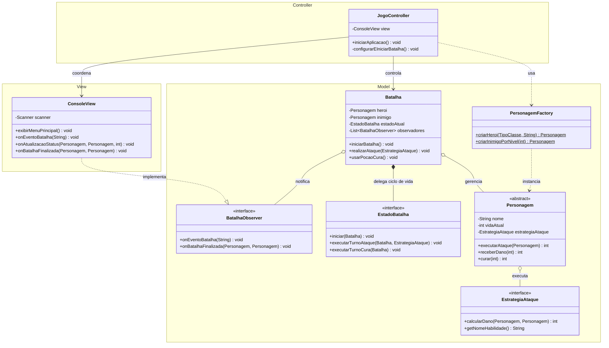

# ⚔️ Arena RPG — Sistema de Batalha em Turnos (MVC & Design Patterns)

> **Instituição:** Centro Universitário Senac  
> **Curso:** Tecnologia em Análise e Desenvolvimento de Sistemas (TADS)  
> **Disciplina:** Engenharia e Arquitetura de Software — Avaliação A3  
> **Autor:** João Pedro Cavanhas Colombo  
> **Repositório:** [github.com/joaocavanhass/rpg-mvc-ead](https://github.com/joaocavanhass/rpg-mvc-ead)

---

## 📋 1. Sobre o Projeto

O **Arena RPG** é uma aplicação desenvolvida em **Java** via interface de console que simula combates estratégicos por turnos entre um herói customizado pelo jogador e diferentes oponentes da arena. 

O projeto foi arquitetado para atender integralmente aos requisitos da **Avaliação A3**, aplicando rigorosamente a separação de responsabilidades da arquitetura **MVC (Model-View-Controller)** e implementando **quatro padrões de projeto (GoF)** distintos de forma funcional e justificada.

---

## 🛠️ 2. Requisitos Técnicos e Ambiente

* **Versão do Java:** Java SE **17 ou superior** (desenvolvido e validado no **JDK 25**).
* **Dependências Externas:** Nenhuma. O projeto utiliza apenas a biblioteca padrão do Java (`java.util`), dispensando Maven, Gradle ou JARs externos para facilitar a compilação e execução em qualquer ambiente.
* **Persistência:** Em memória durante o ciclo de vida da partida.

---

## 🚀 3. Instruções de Compilação e Execução

### Opção A: Executando a partir do arquivo ZIP entregue (Terminal / CMD / PowerShell)
1. Extraia o arquivo `.zip` do projeto em uma pasta de sua preferência.
2. Abra o terminal (Prompt de Comando, PowerShell ou Bash) **na pasta raiz do projeto** (onde estão as pastas `src` e o arquivo `README.md`).
3. Compile todos os arquivos `.java` para um diretório de saída `bin`:
   * **Windows (PowerShell / CMD):**
     ```powershell
     mkdir bin -Force
     javac -encoding UTF-8 -d bin -sourcepath src src\br\senac\rpg\Main.java
     ```
   * **Linux / macOS:**
     ```bash
     mkdir -p bin
     javac -encoding UTF-8 -d bin -sourcepath src src/br/senac/rpg/Main.java
     ```
4. Execute a aplicação:
   ```bash
   java -cp bin br.senac.rpg.Main
   ```

### Opção B: Executando via Git Clone
```bash
git clone [https://github.com/joaocavanhass/rpg-mvc-ead.git](https://github.com/joaocavanhass/rpg-mvc-ead.git)
cd rpg-mvc-ead
javac -encoding UTF-8 -d bin -sourcepath src src/br/senac/rpg/Main.java
java -cp bin br.senac.rpg.Main
```

### Opção C: Executando pela IDE (VS Code, IntelliJ IDEA ou Eclipse)
1. Abra a pasta raiz do projeto na sua IDE Java.
2. Aguarde o reconhecimento automático da pasta `src` como *Source Root*.
3. Abra o arquivo `src/br/senac/rpg/Main.java` e clique em **Run** (`main`).

---

## 🎮 4. Funcionalidades Implementadas e Regras do Jogo

1. **Cadastro e Seleção de Personagem:**
   * O jogador informa o nome do herói (com validação contra entradas vazias).
   * Escolha entre **3 classes jogáveis** com atributos balanceados:
     * **Guerreiro:** HP `140` | ATQ `22` | DEF `14` *(Alta resistência)*
     * **Mago:** HP `95` | ATQ `32` | DEF `6` *(Dano ofensivo elevado)*
     * **Arqueiro:** HP `115` | ATQ `27` | DEF `10` *(Atributos equilibrados)*
2. **Seleção de Oponente (Níveis de Dificuldade):**
   * **Nível 1 (Fácil):** Goblin Saqueador (HP `90` | ATQ `18` | DEF `6`)
   * **Nível 2 (Médio):** Cavaleiro Sombrio (HP `130` | ATQ `24` | DEF `12`)
   * **Nível 3 (Difícil):** Dragão Ancião (HP `180` | ATQ `30` | DEF `15`)
3. **Controle de Turnos e Ações Dinâmicas:**
   * A cada turno, o jogador escolhe entre **3 estratégias de ataque** (`Ataque Básico`, `Golpe Pesado` com 150% de dano e 70% de precisão, ou `Disparo Arcano` que perfura parte da defesa) ou utiliza uma **Poção de Cura** (+35 HP, limite de 2 por partida).
   * Após a ação do herói, o inimigo executa seu contra-ataque automaticamente.
4. **Condições de Vitória, Derrota e Validações:**
   * A batalha encerra imediatamente quando o HP de um dos combatentes chega a `0`, exibindo o vencedor e o perdedor.
   * **Tratamento de Erros e Estado:** O sistema bloqueia entradas não numéricas nos menus, impede o uso de poções quando o estoque chega a zero e bloqueia tentativas de realizar ações incompatíveis com o estado atual da partida (ex.: atacar antes de iniciar ou após o término da luta).

---

## 🏗️ 5. Arquitetura MVC (Model-View-Controller)

A organização em pacotes separa estritamente a interface de usuário, o controle de fluxo e as regras de negócio:

```text
src/br/senac/rpg/
├── Main.java                            # Ponto de entrada: instancia View e Controller
├── controller/
│   └── JogoController.java              # Camada Controller: valida entradas e coordena o fluxo
├── view/
│   └── ConsoleView.java                 # Camada View: exibe menus, lê teclado e observa o Model
└── model/                               # Camada Model: entidades, regras e Design Patterns
    ├── Batalha.java                     # Orquestrador da partida (Contexto State / Subject Observer)
    ├── entity/
    │   ├── Personagem.java              # Classe abstrata base com regras de dano, cura e status
    │   ├── Guerreiro.java               # Subclasse concreta
    │   ├── Mago.java                    # Subclasse concreta
    │   ├── Arqueiro.java                # Subclasse concreta
    │   └── Inimigo.java                 # Subclasse concreta de oponente
    ├── factory/
    │   ├── TipoClasse.java              # Enumeração das classes disponíveis
    │   └── PersonagemFactory.java       # Padrão Factory Method
    ├── strategy/
    │   ├── EstrategiaAtaque.java        # Interface do Padrão Strategy
    │   ├── AtaqueBasicoStrategy.java    # Estratégia concreta 1
    │   ├── AtaquePesadoStrategy.java    # Estratégia concreta 2
    │   └── AtaqueMagicoStrategy.java    # Estratégia concreta 3
    ├── state/
    │   ├── EstadoBatalha.java           # Interface do Padrão State
    │   ├── EstadoPreparacao.java        # Estado inicial antes do combate
    │   ├── EstadoEmAndamento.java       # Estado ativo de turnos e contra-ataques
    │   └── EstadoFinalizado.java        # Estado final que bloqueia novas ações
    └── observer/
        └── BatalhaObserver.java         # Interface do Padrão Observer
```

| Camada | Classes Principais | Responsabilidade na Aplicação |
| :--- | :--- | :--- |
| **Model** | `Batalha`, `Personagem` (e subclasses), pacotes `factory`, `strategy`, `state`, `observer` | Encapsula dados, cálculos de dano/cura, regras de turno e máquinas de estado, sem qualquer dependência de `Scanner` ou `System.out`. |
| **View** | `ConsoleView` | Exibe menus, mensagens de erro e recebe entradas via terminal; implementa `BatalhaObserver` para reagir automaticamente às mudanças do `Model`. |
| **Controller** | `JogoController` | Recebe as ações da `View`, valida entradas do usuário, aciona os métodos da `Batalha` e captura exceções de regra de negócio (`IllegalStateException`). |

---

## 🧩 6. Padrões de Projeto (Design Patterns) Aplicados

Além da arquitetura MVC, foram implementados **4 padrões de projeto distintos**:

### 1. Factory Method (Padrão Criacional)
* **Classes Envolvidas:** `PersonagemFactory`, `TipoClasse`, `Personagem`, `Guerreiro`, `Mago`, `Arqueiro`, `Inimigo`.
* **Problema Resolvido:** Evita que o `JogoController` conheça detalhes de instanciação e valores de balanceamento (HP, ataque, defesa) de cada tipo de personagem.
* **Justificativa:** Centraliza a criação de heróis (`criarHeroi`) e inimigos (`criarInimigoPorNivel`), facilitando a manutenção e a adição de novas classes no futuro.

### 2. Strategy (Padrão Comportamental)
* **Classes Envolvidas:** `EstrategiaAtaque` (interface), `AtaqueBasicoStrategy`, `AtaquePesadoStrategy`, `AtaqueMagicoStrategy` e `Personagem` (contexto).
* **Problema Resolvido:** Elimina condicionais rígidas (`if/else` ou `switch`) dentro da classe `Personagem` para calcular diferentes tipos de golpe.
* **Justificativa:** Permite trocar dinamicamente o algoritmo de ataque de um combatente em tempo de execução a cada turno da batalha.

### 3. State (Padrão Comportamental)
* **Classes Envolvidas:** `EstadoBatalha` (interface), `EstadoPreparacao`, `EstadoEmAndamento`, `EstadoFinalizado` e `Batalha` (contexto).
* **Problema Resolvido:** Controla o ciclo de vida da partida e impede operações incompatíveis com o estado atual (como tentar iniciar uma luta já em andamento ou atacar após o fim da partida).
* **Justificativa:** Encapsula o comportamento específico de cada fase do jogo em classes próprias, garantindo transições seguras (`Preparação -> Em Andamento -> Finalizada`).

### 4. Observer (Padrão Comportamental)
* **Classes Envolvidas:** `BatalhaObserver` (interface), `Batalha` (Subject/Publicador) e `ConsoleView` (Observer/Assinante).
* **Problema Resolvido:** Evita o acoplamento direto entre a camada `Model` e a saída de console (`System.out.println`).
* **Justificativa:** Sempre que ocorre um evento na batalha (dano causado, cura aplicada, atualização de HP ou fim de jogo), `Batalha` notifica todos os observadores registrados automaticamente.

---

## 📊 7. Diagrama de Classes Simplificado

